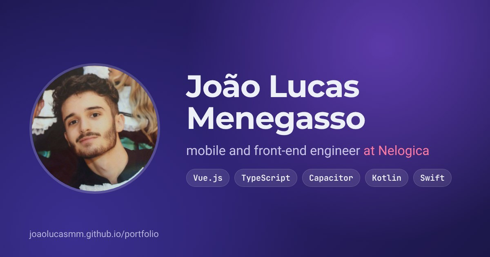

# João Lucas — portfolio

My personal site: who I am, what I've built and where I've worked, in English and Portuguese.

**Live:** https://joaolucasmm.github.io/portfolio/ · **Preview of `Development`:** https://joaolucasmm.github.io/portfolio-dev/



## Stack

- **React 18** and **TypeScript** (strict), built with **Vite**: plain function components and hooks, no UI library.
- **Sass** for the styles: one stylesheet, design tokens as CSS custom properties, light and dark themes.
- **WebGL** for the ink backdrop (`src/Components/Backdrop`), a fragment shader whose palette shifts from section to section. It starts once the page is idle, compiles off the main thread where the GPU allows, and holds still for visitors who ask for reduced motion.
- **EmailJS** for the contact form, so the site stays static.

## What's in it

- **Two languages from one source.** Every text on the page lives in [`src/content.ts`](src/content.ts), once in English and once in Portuguese. Both are typed with the same `Copy` interface, so a missing text fails to compile, and a test also catches a list item or text one language has and the other lacks.
- **Accessibility as a requirement.** Skip link, real tabs and dialogs with focus handling, keyboard navigation everywhere (arrow keys in lists, `Ctrl K` search, `Alt 1–4` to jump to sections), `prefers-reduced-motion` respected. Checked by `jest-axe` in the unit tests and by Lighthouse in CI.
- **Search palette** (`Ctrl K`) over projects, roles, skills and actions.
- **Projects that run in place.** Web projects can be opened live inside the page.
- **Fast first screen.** The page is prerendered at build time (`src/entry-server.tsx`, `scripts/prerender.mjs`) and hydrated in the browser, so the first paint does not wait for the JavaScript. The fonts are self-hosted and load after that first paint; the shader waits for an idle moment. Lighthouse on a simulated phone went from 0.53–0.66 to 0.91, with the blocking time down from about 1 s to under 100 ms. A test hydrates the prerendered page and fails on any mismatch.

## Running it

```bash
npm ci
npm start            # dev server at http://localhost:5173/portfolio-dev/
npm test             # unit and accessibility tests (Vitest + Testing Library + jest-axe)
npm run lint         # ESLint, no warnings allowed
npm run typecheck    # TypeScript, the app and vite.config.mts
npm run build        # production build in build/
npm run serve:build  # serves build/ at /portfolio-dev/, as GitHub Pages does
npm run e2e          # Playwright, desktop and phone, against the served build
npm run size         # fails if the bundle grows past its budget
```

## CI and deploy

[`.github/workflows/build-test-deploy.yml`](.github/workflows/build-test-deploy.yml) runs on every pull request and push to `main` and `Development`:

| Job | What it checks |
|---|---|
| `build` | ESLint with no warnings, type check, production build, bundle size |
| `test` | Unit and accessibility tests, with coverage |
| `e2e` | Playwright on a desktop and a phone viewport |
| `lighthouse` | Accessibility, best practices and SEO ≥ 90; performance warns under 90 |
| `links` | Every external link on the page still answers |
| `audit` | `npm audit` on production dependencies, critical advisories |

A push to `Development` deploys to the preview site on GitHub Pages; a push to `main` publishes to the production repository, [`joaolucasmm/portfolio`](https://github.com/joaolucasmm/portfolio). The workflow can also be run by hand from the Actions tab.

## Layout

```
src/
  content.ts          all copy, both languages, and the types it follows
  App.tsx             page composition, theme and language state
  Components/         one folder per section (Hero, About, Projects, Experience, …)
  Functions/          hooks: shortcuts, reveal on scroll, dialog focus, phone layout
  Assets/style/       the stylesheet
e2e/                  Playwright tests
scripts/              local server for the build, bundle size check
```

## Contact

[LinkedIn](https://www.linkedin.com/in/jo%C3%A3o-lucas-miranda-menegasso/) · joaol_mm@hotmail.com
